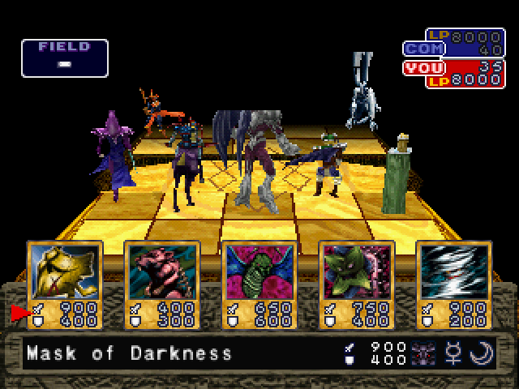
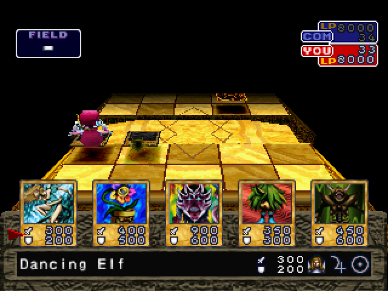
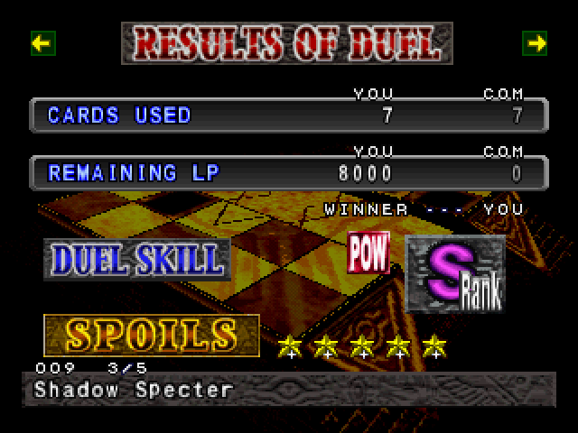

# Yu-Gi-Oh! Forbidden Memories — 3D Monsters

A fan patch for the PlayStation game *Yu-Gi-Oh! Forbidden Memories* (Konami, USA release, disc code
**SLUS-01411**) that makes the monsters on the duel field **stand on their cards as 3D models**. It runs on the
original PlayStation game (real console or PS1 emulator), not on a PC port. It also makes **all 722 cards
obtainable** without cheats.

The game is otherwise unchanged: original English text, rules, opponents and story.

This is a free, non-commercial fan project, not affiliated with or endorsed by Konami. The download contains **no
game data**: you need your own disc image, and the patch only writes the new code and a few changed table values
onto it.

[](https://www.paypal.com/donate/?business=khuongkid92%40gmail.com&currency_code=USD)

## Two patches — pick one

| Patch | Contents |
|---|---|
| `yugioh-fm-3d.ppf` | 3D monsters + all 722 cards obtainable. A won duel gives **1** card, as in the original. |
| `yugioh-fm-3d-5cards.ppf` | Same as above, and a won duel gives **5** cards. |

Both patches are applied **directly to the original disc image** (do not apply one on top of the other). To switch,
patch a fresh copy of the original. Memory card saves work with both patches and with the original game.

Files in this repository:

| File | Purpose |
|---|---|
| `yugioh-fm-3d.ppf` | Patch: 3D monsters + all 722 cards, 1 card per win (PPF 3.0) |
| `yugioh-fm-3d-5cards.ppf` | Patch: 3D monsters + all 722 cards, 5 cards per win (PPF 3.0) |
| `apply_patch.py` | Python patcher: recognises the patch, checks SHA-256 before and after, creates the `.cue` |
| `create_cue.bat` | Creates a `.cue` file for a `.bin` (drag and drop, or double-click) |
| `docs/all-722-cards.md` | Every drop, price and password the patches change |
| `docs/images/` | Screenshots used in this README |

## Screenshots

| | |
|---|---|
|  |  |
| Face-up monsters on both sides of the field (the board was filled for this screenshot) | A story-mode duel at the Duel Ground |
|  | |
| Result screen of the **5-card patch**: card 3 of the 5 cards won | |

## What the patches do

### 3D monsters on the field (both patches)

- Every face-up monster on the field, yours and your opponent's, stands on its card as a 3D model. These are the
  game's own models: the ones it normally shows only in the 3D battle animation. All 621 monster cards have one.
- The monster you interacted with last (summoned, flipped, attacked with or attacked) is the live, animated model.
  The others show a still 3D image of their model.
- The models appear in the normal angled duel view during your turn. The overhead view, the card close-ups and the
  battle animations look as in the original game.
- Everything the patch borrows from the console's video memory during a duel is put back when the duel ends, so the
  screens after a duel look as in the original.

### All 722 cards (both patches)

In the original game 82 cards never drop from any opponent and 122 cards cost 999,999 star chips (the maximum you can
own; a won duel gives 1-5 chips), 24 of them without a password. Both patches fix this:

- the 82 cards are added to the S/A-rank drop tables of opponents who use them in their own deck (every card that
  dropped before still drops; its chance is scaled down slightly to make room);
- every card that cost 999,999 gets a price by level (50 to 6,000 star chips; magic, trap, ritual and equip cards
  1,000; each Exodia piece 3,000);
- the 24 cards without a password get their real Yu-Gi-Oh! card password.

The full list (opponents, passwords, old and new prices) is in [docs/all-722-cards.md](docs/all-722-cards.md).
Opponent decks and the B/C/D drop tables are unchanged.

### 5 cards per win (`yugioh-fm-3d-5cards.ppf` only)

- A won duel gives 5 cards: the card the game picks as usual, plus 4 more drawn from the same drop table (same rank).
- The result screen shows all 5: the counter after the card number (`1/5` … `5/5`) tells which one is shown. It
  switches to the next card every 3 seconds; press **UP / DOWN** to browse them yourself.
- All 5 cards go to your chest when you leave the result screen.

## How to patch

### 1. The original disc image

You need a **`.bin` + `.cue`** image (Mode 2, 2352 bytes per sector) of the USA disc SLUS-01411, as made by common PS1
disc ripping tools in "BIN/CUE" mode.

- The image must be **a single `.bin` file**. A `.cue` that lists several files (Track 01, Track 02…) is a split
  dump and cannot be used directly.
- An `.iso` (2048 bytes per sector) or a compressed format (`.chd`, `.pbp`, `.ecm`…) does not work: convert it back to
  a single `.bin` first.

SHA-256 of the correct original `.bin`:

```
6e22494a45bf50fa2d239cd3819a57163a5f9b91e0365babc3e101509b5c3a7c
```

On Windows you can check it in PowerShell:

```powershell
Get-FileHash "Yu-Gi-Oh! Forbidden Memories (USA).bin" -Algorithm SHA256
```

### 2a. Patch with PPF-O-Matic (Windows)

PPF-O-Matic 3 patches the file **in place**, so first make a copy of your original `.bin` and patch the copy.

1. Open PPF-O-Matic, select the copied `.bin` as the image and one of the `.ppf` files as the patch.
2. Click **Apply**; it should say the patch was applied successfully.
3. Give the patched `.bin` a `.cue` file with the same name (`create_cue.bat` does it, see step 3).

### 2b. Patch with `apply_patch.py` (any system with Python 3)

```
python apply_patch.py "Yu-Gi-Oh! Forbidden Memories (USA).bin" yugioh-fm-3d.ppf
```

or, for the 5-card patch:

```
python apply_patch.py "Yu-Gi-Oh! Forbidden Memories (USA).bin" yugioh-fm-3d-5cards.ppf
```

The script checks the original's SHA-256, writes a new file next to it (the original is not modified) and creates
the matching `.cue`:

- `Yu-Gi-Oh! Forbidden Memories (3D).bin` / `.cue` for `yugioh-fm-3d.ppf`
- `Yu-Gi-Oh! Forbidden Memories (3D)(Mod5).bin` / `.cue` for `yugioh-fm-3d-5cards.ppf`

A third argument chooses another output name. At the end it prints `MATCHES the release` when the result is
byte-identical to the tested release.

### 3. The `.cue` file

Emulators open the `.cue`, which must name the `.bin` exactly. `apply_patch.py` creates it. Otherwise drag the
patched `.bin` onto `create_cue.bat`, or put the bat file next to the `.bin` and double-click it.

### 4. Check the result

SHA-256 of the patched `.bin`:

| Patch | SHA-256 of the patched disc |
|---|---|
| `yugioh-fm-3d.ppf` | `4c3fa18fd6ef4baa5d96842c0d4f3d72efb07e8529ab5dc633f2c12a028cdc04` |
| `yugioh-fm-3d-5cards.ppf` | `ceec87a53e0e3778f00c730972fb909dfc66647a5213bd0ac61f9004b86ba9a0` |

## Known limitations

- At most 8 monsters are shown in 3D at the same time (the live model + 7 still images). When more monsters are face
  up, the others stay flat cards.
- A large monster in the front row can be cut off at the edges of its still image (each one is a 64×64 picture). The
  live model is never cut.
- Tested in the PCSX-Redux emulator: Free Duel with both patches, story-mode duels at the Duel Ground with the 5-card
  patch, the result screen, the deck screen and the next duel. Not tested yet: a real PlayStation, other emulators,
  high internal-resolution modes. Please report what you find.

## Reporting problems

Open an issue on this repository with: the emulator (name and version) or console, which patch you used, the SHA-256
of your patched `.bin`, and a screenshot if possible.

## Support

The patch is free. If you enjoy it and want to support the work, you can donate with PayPal:

[](https://www.paypal.com/donate/?business=khuongkid92%40gmail.com&currency_code=USD)

PayPal: **khuongkid92@gmail.com**

## Credits

- Patch by **KhuongKid**.
- New passwords from Yugipedia and YGOPRODeck.
- *Yu-Gi-Oh! Forbidden Memories* © Konami. Yu-Gi-Oh! © Kazuki Takahashi.
